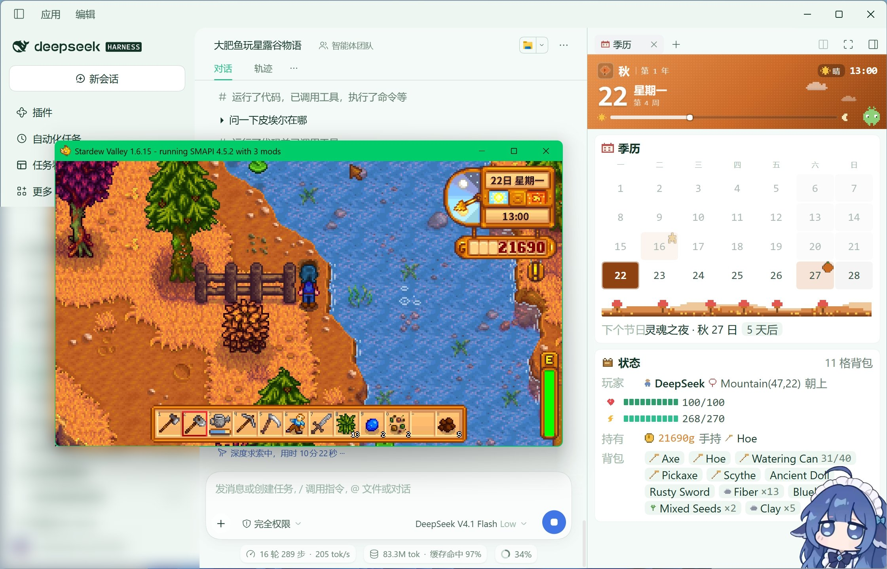

# dsh-junimo

[简体中文](README.md) · **繁體中文** · [English](README.en-US.md) · [Español](README.es-ES.md)

DeepSeek Harness 外掛，為《星露谷物語》提供 37 個操控工具，並補足 MCP 層無法涵蓋的部署自檢與遊戲生命週期管理。

## 概述

本儲存庫是一個 **dsh 組合包（bundle）**，作用於 [DeepSeek Harness](https://github.com/deepseek-ai/deepseek-harness) 的 profile 層。

遊戲邏輯不在此實作。全部 37 個工具由 [Junimo-MCP](https://github.com/mlkgrnt/Junimo-MCP) 的 `junimo-mcp.exe`（OCaml，單一檔案）提供，經官方 `@deepseek-ai/dsh-mcp-client` 以 stdio MCP 協定橋接，模型側呈現為 `mcp__junimo__<工具名>`。**本儲存庫不修改 Junimo-MCP 的任何程式碼。**

外掛自身承擔四項職責：

1. 裝配 MCP 橋接，並提供 `junimoPaths` 服務作為 exe、skill 目錄的唯一真源
2. 向系統提示詞注入星露谷操作紀律，規避時序與存檔類常見錯誤
3. 註冊 4 個原生工具：診斷、視窗聚焦、遊戲啟動、讀檔
4. 在 dsh Web UI 右側邊欄註冊一塊唯讀的「季歷面板」

第 3 項無法由 MCP 工具實作——mod 執行於遊戲行程內部，不能啟動自身行程，也不能將自身視窗置前。第 4 項由一條宿主路由加一份預先建置的用戶端 bundle 實作，見「[季歷面板](#季歷面板)」。

`junimo-mcp.exe` 已隨包內建（`bin/`，v3.2.1，6 MB），安裝外掛後無需另行取得二進位檔。

## 架構

```
模型 ──mcp__junimo__*──▶ dsh-mcp-client ──stdio──▶ junimo-mcp.exe ──HTTP──▶ NagiBridge-Remix ──▶ 遊戲
                              ▲                          ▲
                        dsh-junimo 裝配             原樣重用，未修改
                        + 4 個原生工具
```

| 組成 | 提供方 | 說明 |
|---|---|---|
| 37 個遊戲工具 | `@deepseek-ai/dsh-mcp-client` + 內建 exe | 感知、移動、互動、介面、農活、箱子、社交、節慶、生計 |
| 4 個原生工具 | 本外掛 | `junimo_doctor` / `junimo_focus` / `junimo_game_launch` / `junimo_load_save` |
| 提示詞紀律 | 本外掛 | 系統提示詞段落 `junimo:rules`，約 1000 字元 |
| 隨包 skill | `@deepseek-ai/dsh-skill-filesystem` | `skills/junimo/`，按需載入，不佔常駐上下文 |
| 參考文件 | 本外掛 | `reference/game-semantics.md`，含工具速查表與已知邊界 |
| 季歷面板 | 本外掛 | 右側邊欄唯讀面板：宿主路由 `GET /junimo/panel` + 預先建置的 `client/index.js` |

## 前置要求

| 項 | 要求 |
|---|---|
| 作業系統 | Windows（核心與外掛、mod 三層的平台現況不同，見「[平台支援](#平台支援)」） |
| dsh | `>= 0.2.1-rc.2`（宣告於 `package.json` 的 `dsh.engines`） |
| 遊戲 | Stardew Valley 1.6.x |
| SMAPI | 4.x（`junimo_game_launch` 依賴它啟動） |
| POSIX shell | Git for Windows 或 WSL 的 bash，用於啟動遊戲。缺少時退回 `cmd`，可正常啟動，但會多出一個 SMAPI 主控台視窗 |
| 執行器 mod | [NagiBridge-Remix](https://github.com/pendel001/NagiBridge-Remix)，安裝至 `Mods/NagiBridge/` |

SMAPI 與 mod 的安裝步驟見 [Junimo-MCP 的 AGENTS.md](https://github.com/mlkgrnt/Junimo-MCP/blob/main/AGENTS.md)。

> NagiBridge-Remix 採用 PolyForm Noncommercial 1.0.0 授權，個人與非商業用途免費。本專案不打包其程式碼。原版 NagiBridge 與 Remix 的 UniqueID 不同，同時安裝會爭用 7842 連接埠，切換時需先移出舊目錄。

## 安裝

```bash
# 本機 checkout
dsh plugin --profile web add link:/path/to/dsh-junimo

# 或直接從 GitHub 安裝（純 ESM 原始碼，無建置步驟）
dsh plugin --profile web add github:mlkgrnt/dsh-junimo
```

`dsh plugin add` 會初始化 profile，並將本包附加至 `dsh.profile.bundles`。重新啟動 dsh 後生效。

安裝後執行 `junimo_doctor` 完成鏈路檢查。該工具輸出 exe 路徑與版本、7842 連接埠狀態、mod 回應、存檔就緒狀態、SMAPI 與 NagiBridge 檔案完整性，以及 SMAPI 日誌中的錯誤行。

> 從 GitHub 安裝時若提示建置腳本未授權，將 pnpm 給出的包鍵加入 profile 的 `pnpm-workspace.yaml` 的 `allowBuilds`。本包不含建置步驟，通常不會觸發。

## 設定

### 環境變數

| 變數 | 預設值 | 說明 |
|---|---|---|
| `JUNIMO_MCP_BIN` | 內建 `bin/junimo-mcp.exe` | 覆寫內建 exe，用於升級、回退或使用自編譯版本 |
| `STARDEW_GAME_DIR` | 自動偵測 | 含 `Stardew Valley.exe` 的目錄；未設定時依次嘗試 Steam 庫與常見安裝路徑 |
| `STARDEW_API_URL` | `http://localhost:7842` | mod 端點。必須使用 `localhost`，`127.0.0.1` 會被系統拒絕 |
| `STARDEW_AUTO_MENU` | `1` | 透傳給 exe：自動應答無選項對話 |
| `STARDEW_AUTO_EVENT` | 未設定 | 透傳給 exe：自動跳過劇本事件，預設關閉 |

exe 自身的其餘變數（`STARDEW_HTTP`、`STARDEW_SETTLE` 等）見 Junimo-MCP 的 README，同樣可透過 `cordis.patch.yml` 中的 `env` 透傳。

### 覆寫外掛預設設定

profile 的 `cordis.patch.yml` 按 `id` 覆寫外掛行。patch 會整體替換 `config`，需完整重述所有鍵：

```yaml
- insert:
    - id: junimo-mcp
      name: '@deepseek-ai/dsh-mcp-client'
      inject: [junimoPaths]
      config:
        serverName: junimo
        transport: stdio
        command: 'D:\tools\junimo-mcp.exe'
        args: []
        env: { STARDEW_API_URL: 'http://localhost:7842' }
        cwd: 'D:\tools'
        toolCallTimeoutMs: 180000
        failOnStartupError: true
```

## 工具

### 原生工具

| 工具 | 用途 |
|---|---|
| `junimo_doctor` | 鏈路診斷。唯讀，不執行修復。操作遊戲前應首先呼叫 |
| `junimo_focus` | 將遊戲視窗置前。SDV 失焦會自動暫停，此時點擊與選單操作均不生效 |
| `junimo_game_launch` | 透過 `StardewModdingAPI.exe` 啟動遊戲並等待 7842 回應；已在執行時不會重複啟動。SMAPI 是主控台程式，直接 spawn 會秒退，因此優先經 bash 啟動，找不到 bash 才退回 `cmd` |
| `junimo_load_save` | 聚焦視窗 → 點擊 Load → 點擊存檔格 → 輪詢至 `worldReady`，失敗時整輪重試 |

`junimo_load_save` 的難點在於時機而非座標。`TitleMenu.receiveLeftClick` 在淡入與轉場期間會靜默丟棄點擊，因此實作採用「等待介面穩定 → 點擊 → 以 `worldReady` 判定 → 整輪重試」。座標基於 1280×720 視窗模式的標題介面。

### 橋接工具

37 個 `mcp__junimo__*` 工具的完整清單、參數與注意事項見 [`reference/game-semantics.md`](./reference/game-semantics.md)。

其中 `story` 的 `choose` 在 `junimo-mcp.exe` 內部採用兩段式：預設路徑先向遊戲登記答案，若介面未推進則自動補發一次真實點擊。實機驗證（寵物領養事件）選完即推進到下一幕。呼叫方不需要、也不應再補第二發點擊。

## 季歷面板

外掛在 dsh Web UI 的**右側邊欄**註冊一塊唯讀觀測面板「星露谷季歷」，把遊戲目前狀態攤在對話旁邊，方便人隨時對照模型正在做什麼。



展開右側邊欄（`Ctrl+Shift+B`）後點「星露谷季歷」即可。面板分三塊：

| 區塊 | 內容 |
|---|---|
| 季節卡 | 季節、第幾年、日期、星期、週數、天氣圖示、目前時刻，以及當日進度條 |
| 季歷 | 4×7 排滿一季 28 天；週末有底色，今日高亮，節慶與趕不上的節慶各有標記 |
| 狀態卡 | 玩家名、所在地圖與座標、朝向、HP 與體力條、金錢、手持物、背包（澆水壺附水量）；選單開啟時顯示選單類型，劇本事件進行中時顯示劇情橫幅 |

日曆下方另給**下一個節慶的名稱與倒數**（如「靈魂之夜 · 秋 27 日 5 天後」）。

### 資料來源

瀏覽器**連不上** `http://localhost:7842`：桌面端頁面執行在 `dsh-app://` 協定之下，直連既不跨來源，也會被該自訂協定攔下。因此面板資料由外掛在**宿主行程內**代理：

```
瀏覽器 ──GET /junimo/panel──▶ dsh 宿主（本外掛的 webServer 路由） ──HTTP──▶ NagiBridge /state ──▶ 遊戲
```

`src/panel.js` 把 mod 面向模型的中文長文字狀態收成前端可直接渲染的小 DTO：數值欄位一律兜住型別（mod 在部分階段會給 `null` 或字串），缺欄位退化為空值而不拋錯。

前端每 5 秒輪詢一次，請求帶 `AbortSignal`，面板卸載即取消。

### 降級行為

面板是觀測面，異常不該讓瀏覽器拿到壞回應——路由任何情況下都回傳 200 與可渲染的 JSON：

| 情境 | 表現 |
|---|---|
| 遊戲未啟動 / mod 未載入 | 標頭灰化為「未連線」，日曆仍依目前季節渲染，狀態卡顯示「連不上遊戲（mod 沒起來，或遊戲沒開）」 |
| 停在標題畫面、尚未進檔 | 同上，標註「未進檔」 |
| mod 回應逾時 | 仍回傳 200，附 `error` 欄位（預設 2.5 秒逾時，模態介面下 mod 會卡住） |

### 只為 web profile 註冊

面板路由掛在 `ctx.inject(['webServer'])` 裡**按需註冊**，不放入外掛的頂層 `inject`。headless / tui profile 沒有 `webServer` 服務，若在頂層宣告這個依賴，整個外掛——包括 37 個工具的裝配與提示詞段落——會一起無法啟動；按需注入時缺服務只是這一條不生效。

用戶端 bundle 由 `package.json` 的 `dsh.client` 欄位宣告（`platform: web`），依賴 `dsh-client-ui-renderer` / `dsh-client-ui-tool` / `dsh-client-ui-sidebar-right`；`client/index.js` 是預先建置的產物，安裝後無需再建置。

## 維護

### 同步內建 exe

```bash
node scripts/sync-binary.mjs          # 取 Junimo-MCP 的最新 release
node scripts/sync-binary.mjs v3.2.1   # 或鎖定指定 tag
```

腳本下載 exe 與官方 SHA-256，本機校驗通過後才覆寫 `bin/`，並同步更新 `bin/BUNDLED_VERSION`。完成後需 `git add bin/` 並提交。

目前內建版本見 `bin/BUNDLED_VERSION`。

## 開發

### 目錄結構

```
src/index.js    外掛入口：junimoPaths 服務、提示詞段落、4 個工具註冊
src/paths.js    exe / 遊戲目錄 / 包內資源的解析與偵測
src/api.js      NagiBridge 的最小 HTTP 客戶端（探活與時序兜底）
src/doctor.js   junimo_doctor 的檢查項與渲染
src/game.js     聚焦、啟動、讀檔
src/panel.js    季歷面板 DTO：把 mod 的 /state 收成前端可直接渲染的形狀
client/index.js 季歷面板的用戶端 bundle（預先建置，由宿主直接 serve）
docs/           README 用的截圖
skills/         隨包 skill
reference/      按需讀取的長文件
scripts/        維護腳本
test/           冒煙與實機驗證腳本
```

原始碼為純 ESM JavaScript，無建置步驟，`src/*.js` 即發佈產物。

### 測試

```bash
node test/smoke.mjs                    # 離線冒煙，不需要遊戲與 dsh 宿主
node test/verify-load-save.mjs         # 實機：啟動遊戲、讀檔，校驗 worldReady
node test/verify-load-save.mjs --existing   # 遊戲已手動啟動時，僅驗證讀檔

node test/panel-dto.mjs                # 面板 DTO：各類畸形輸入都退化為「沒連上」
node test/client-bundle.mjs            # 用戶端 bundle 的結構與元件渲染斷言
node test/render-panel.mjs out.html dark  # 產生靜態預覽（light | dark | offline）
```

離線冒煙校驗 `junimoPaths` 服務、提示詞段落、4 個工具的註冊結果、啟動指令的轉義、面板路由（GET 200 / POST 405），並執行一次 `junimo_doctor`。它依賴 `node_modules/@deepseek-ai/dsh-tools` 的本機 stub 以支援直接以 Node 執行；實際部署中該套件由 dsh 宿主提供。

### 在 dsh 中驗證

```bash
dsh plugin --profile <name> add link:/path/to/dsh-junimo
dsh --profile <name> --dump-config | grep -A8 junimo   # 確認三層均已進入組合
dsh --profile <name> --no-open                          # 啟動；出現 "entries did not activate" 即為異常
```

## 平台支援

本外掛目前**只在 Windows 上可用**，但原因分佈在三層，不是整塊缺失。分清這一點對判斷移植成本很重要：

| 層 | 平台現況 | 依據 |
|---|---|---|
| OCaml 核心（`junimo-mcp.exe` 的內容） | **已跨平台，且已發佈 macOS / Linux 產物** | 依賴只有 `yojson` + `unix`，原始碼無平台分支；CI 在 Linux / macOS / Windows 三個 runner 上跑通全部免遊戲斷言；產物發佈前會在各自平台上再跑一遍 |
| 本外掛（行程啟動、視窗聚焦、路徑偵測） | **僅 Windows** | 聚焦用 user32，啟動走 PowerShell 與 bash，Steam 庫按磁碟代號偵測 |
| 執行器 mod（NagiBridge-Remix） | **部分僅 Windows** | `/press_key` 與 `/click_tile` 走 `keybd_event` / `mouse_event`；`/click` 在有選單或帶 `no_mouse` 時走行程內呼叫，本身可移植 |

本外掛隨包只帶 Windows 的 `junimo-mcp.exe`。macOS / Linux 使用者可以從 [Junimo-MCP Releases](https://github.com/mlkgrnt/Junimo-MCP/releases/latest) 取對應產物（`junimo-mcp-macos-arm64` / `junimo-mcp-linux-x86_64`），用 `JUNIMO_MCP_BIN` 指過來即可使用 37 個工具中的大部分；`junimo_doctor` 在非 Windows 上會直接給出該平台對應的下載位址，而不是籠統地報「找不到 exe」。

但**外掛本身**的 `junimo_focus` / `junimo_game_launch` / `junimo_load_save` 仍然只有 Windows 實作——這三個是外掛存在的理由，想用它們需要自己補一份平台適配（聚焦換 `osascript` / `xdotool`，路徑偵測換各平台的 Steam 目錄）。移植的邊界就到這裡。

## 已知限制

- **外掛目前僅 Windows 可用**。視窗聚焦、行程啟動與讀檔依賴 PowerShell 與 user32。但 **Junimo-MCP 已有 macOS / Linux 二進位檔**，可自行下載使用或按需移植外掛三件套。
- **讀檔座標綁定 1280×720 標題介面**。已在視窗模式實機驗證；其它解析度需換算，參見 `src/game.js` 註解。
- **內建的 `junimo-mcp.exe` 為 Junimo-MCP 的發佈產物**（MIT）。本專案不打包 NagiBridge-Remix。

## 授權

MIT，見 [LICENSE](./LICENSE)。內建的 `junimo-mcp.exe` 與 NagiBridge-Remix 各自遵循其原授權。